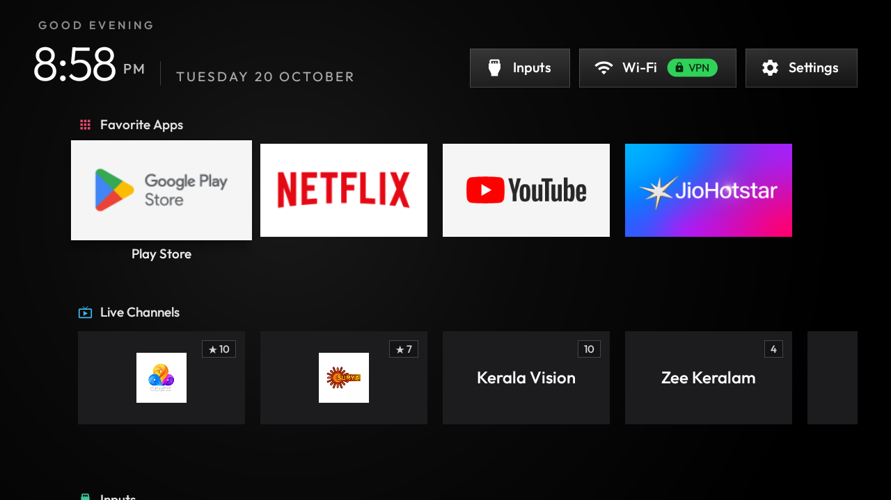
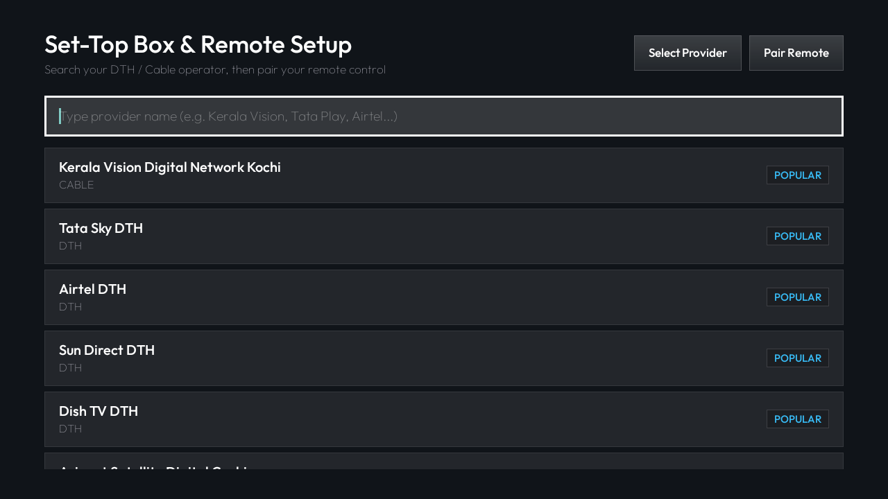
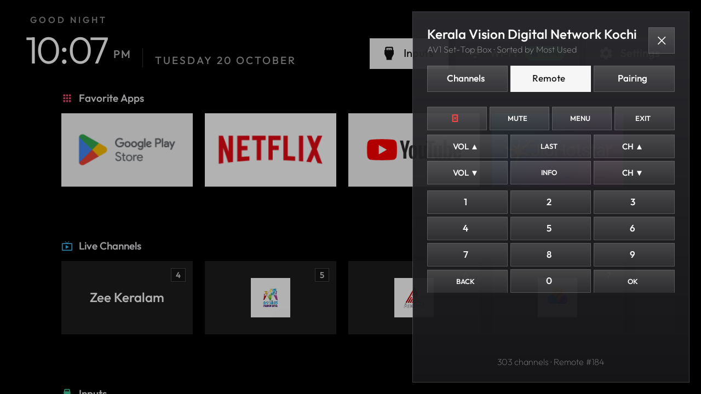
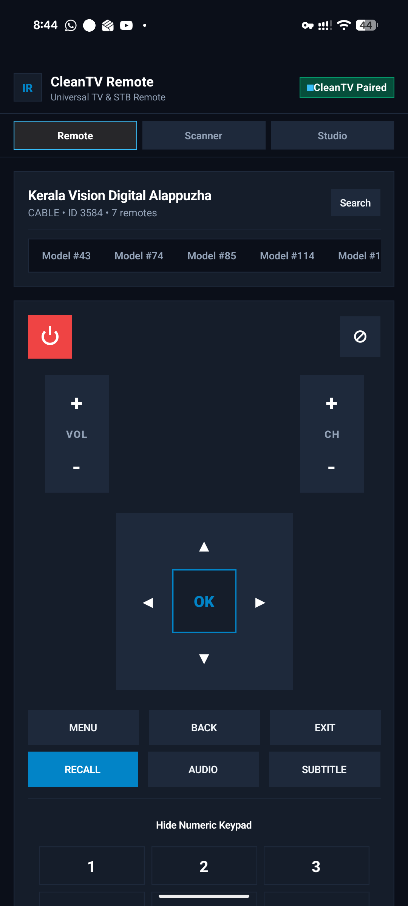
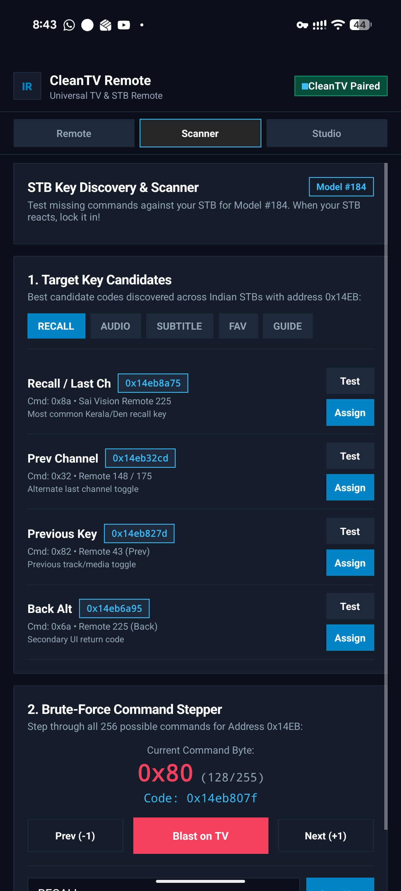

# CleanTV & CleanTV Companion

[](tv-launcher/)
[-61DAFB.svg?logo=react)](mobile/)
[](src/)
[](docs/PROTOCOL.md)
[](LICENSE)

An ultra-fast, zero-bloat Android TV launcher and mobile companion system engineered for TVs with the **Xiaomi / Sensara USB Consumer IR Blaster Dongle (`2717:003d`)**. 

CleanTV turns legacy cable/DTH Set-Top Boxes into first-class smart TV experiences with live channel rails, instant infrared tuning, an on-screen translucent remote sidebar, and encrypted LAN beaming from mobile devices.

---

## Screenshots

| TV Rails & Live Channels | Interactive STB Setup Wizard |
|:---:|:---:|
|  |  |

| Live TV Remote Sidebar | Mobile Companion Remote | Mobile IR Studio & Scanner |
|:---:|:---:|:---:|
|  |  |  |

---

## Key Features

- **Ultra-Fast Leanback Launcher (`dev.ntsv.cleantv`)**:
  - Replaces bloated, ad-heavy stock launchers (PatchWall, Google TV) with zero background overhead.
  - Native Android TV Rails UI displaying installed apps, favorite channels, and live inputs.
  - Custom glass highlight animations, time-of-day ambient background, and speed-compiled ART profile.
- **USB IR Blaster Engine (`2717:003d`)**:
  - Direct hardware driver for Xiaomi/Sensara USB IR dongles on Android TV and mobile USB OTG.
  - Supports 3,700+ providers and Set-Top Box models (Kerala Vision, Tata Play, Airtel DTH, Sun Direct, Dish TV, etc.).
  - Automatic STB configuration wizard on first launch when an IR dongle is detected.
- **CleanTV Companion (`dev.ntsv.cleantvcompanion`)**:
  - React Native mobile app with haptic touch controls, D-Pad navigation, channel selector, and volume/power keys.
  - IR Protocol Scanner & Studio for discovering unknown remotes and capturing timing pulses.
  - Real-time transmission logger with millisecond precision.
- **End-to-End Encrypted LAN Beaming**:
  - Zero-cloud local Wi-Fi control over port `8090`.
  - Authenticated **AES-256-GCM** encryption with **PBKDF2-SHA256** key derivation from an on-screen TV pairing PIN.
  - HMAC integrity verification prevents tampering and replay attacks.
- **Thoughtful Remote UX**:
  - **Live TV Exit Navigation**: Single press of Back cleanly exits back to the Launcher; full STB `BACK` and controls remain accessible anytime via the translucent remote sidebar.
  - **Translucent Remote Sidebar**: Access full STB controls on TV without interrupting live video playback.
  - **Settings Backup & Restore**: Export and import complete provider, channel mapping, and custom key configs across devices.

---

## Architecture

```
                       +---------------------------------------+
                       |    Sensara STB Cloud / Local DB       |
                       |      (3,700+ DTH/Cable Providers)     |
                       +-------------------+-------------------+
                                           |
                   +-----------------------+-----------------------+
                   |                                               |
                   v                                               v
   +-------------------------------+               +-------------------------------+
   |      CleanTV Companion        |  AES-256-GCM  |        CleanTV Launcher       |
   | (dev.ntsv.cleantvcompanion)   | <-----------> |       (dev.ntsv.cleantv)      |
   | - React Native UI             |  Port 8090    | - Android TV Rails Home       |
   | - IR Code Studio & Scanner    |   LAN Wi-Fi   | - Live TV Player Activity     |
   | - Dynamic Remote Sync         |               | - Embedded HTTP Command Server|
   +---------------+---------------+               +---------------+---------------+
                   |                                               |
                   | USB OTG                                       | USB Host
                   v                                               v
       +---------------------------------------------------------------+
       |       Xiaomi / Sensara USB IR Blaster Dongle (VID 0x2717)     |
       +-------------------------------+-------------------------------+
                                       |
                                       | 38kHz NEC Modulated IR
                                       v
                       +-------------------------------+
                       |       Cable / DTH STB         |
                       |    (Kerala Vision, etc.)      |
                       +-------------------------------+
```

---

## Repository Layout

```text
├── tv-launcher/                # Android TV Leanback Launcher (dev.ntsv.cleantv)
│   ├── app/src/main/java/      # Native Java launcher, STB engine, and HTTP server
│   ├── app/src/main/res/       # TV Rails layouts, animations, and design tokens
│   └── build-and-install.sh    # Fast build and zero-downtime ADB deployment
├── mobile/                     # React Native Companion App (dev.ntsv.cleantvcompanion)
│   ├── src/                    # UI Components, Screens, Encryption, and Decoupled Services
│   └── android/                # Native Android wrapper & Sensy USB bridge module
├── research/                   # Hardware reverse-engineering, driver & CLI suite
│   ├── src/                    # TypeScript WebUSB driver & SQLite query engine
│   ├── tests/                  # Hardware TX, NEC encoding, and database test suites
│   ├── sensy_ir.js             # Standalone reverse-engineered prototype script
│   └── lcndb.db                # Reference STB SQLite database
├── tools/                      # Mi TV deployment, ADB batching, and debloating scripts
│   ├── install-mitv4a.sh       # Automated installation and debloat for Mi TV 4A
│   └── restore-mitv4a.sh       # System restore and stock launcher re-enable
└── docs/                       # Technical specs and developer guides
    ├── PROTOCOL.md             # LAN Beaming encryption and REST API documentation
    ├── HARDWARE_IR.md          # Reverse-engineered USB protocol & opcodes
    └── screenshots/            # UI screenshots and visual assets
```

---

## Quick Start

### 1. TV Launcher Installation

Ensure ADB debugging is enabled on your Android TV:

```bash
# Set TV host IP address
export TV_HOST="100.97.35.51:5555"

# Build and install release APK, grant permissions, and set as default Home
cd tv-launcher
./build-and-install.sh
```

Or build manually via Gradle:
```bash
cd tv-launcher
./gradlew assembleRelease
adb install -r app/build/outputs/apk/release/app-release.apk
adb shell cmd package set-home-activity --user 0 dev.ntsv.cleantv/.MainActivity
```

### 2. Mobile Companion App Installation

```bash
cd mobile

# Install dependencies
npm install

# Bundle React Native JavaScript assets
npx react-native bundle --platform android --dev false \
  --entry-file index.js \
  --bundle-output android/app/src/main/assets/index.android.bundle \
  --assets-dest android/app/src/main/res/

# Build and install release APK
cd android
./gradlew assembleRelease
adb -s <DEVICE_ID> install -r app/build/outputs/apk/release/app-release.apk
```

### 3. Standalone Research Driver & CLI

You can also explore the hardware protocol and query the STB database directly from your workstation:

```bash
cd research

# Install dependencies & build
npm install
npm run build

# Check dongle and database status
npm run stb -- --status

# Interactive pairing wizard
npm run stb -- --pair-kerala

# Send specific IR key commands
npm run stb -- --send power
npm run stb -- --send vol_up
npm run stb -- --send 1 0
```
See the [Research & Hardware Engineering Guide](research/README.md) for reverse-engineering details and test suite usage.

---

## Security & Privacy

- **100% Local**: No internet connection, telemetry, or cloud accounts required for STB control or remote beaming.
- **Encrypted Local Beaming**: All LAN commands use AES-256-GCM authenticated with a dynamically generated pairing PIN.
- **Sandboxed Preferences**: Backups contain only STB channel customizations and pairing keys; private user data is never accessed.

---

## OTA Updates

CleanTV supports manual over-the-air (OTA) updates directly from GitHub Releases without any app store.

### How It Works

1. Open the **Settings menu** from the TV launcher home screen (or navigate to **TV Home Settings**).
2. Select **Check for Updates**.
3. The launcher queries the [GitHub Releases API](https://api.github.com/repos/0x006E/cleantv/releases/latest), compares the published tag (`tag_name`) against the currently installed `versionName`, and:
   - If a newer version exists: displays a dialog with the release name and changelog, then prompts to **Update Now**.
   - If already up to date: shows a confirmation dialog (with an option to reinstall the current version).
4. On confirmation, the APK is downloaded with a live progress bar directly to the device cache.
5. The system package installer is launched automatically to apply the update. Because CleanTV uses a consistent release signing key (stored as a GitHub Actions secret), updates install seamlessly over the existing app without clearing data.

> [!NOTE]
> Updates are **never checked automatically** in the background. The check only runs when you explicitly select "Check for Updates".

### Release Signing

All builds published to GitHub Releases are signed with a dedicated release keystore whose key material is stored exclusively as a [GitHub Actions secret](https://docs.github.com/en/actions/security-guides/using-secrets-in-github-actions) (`RELEASE_KEYSTORE_BASE64`). The keystore is never committed to the repository.

| Secret | Purpose |
|--------|---------|
| `RELEASE_KEYSTORE_BASE64` | Base64-encoded `.jks` keystore file |
| `RELEASE_STORE_PASSWORD` | Keystore password |
| `RELEASE_KEY_ALIAS` | Key alias within the keystore |
| `RELEASE_KEY_PASSWORD` | Key password |

The CI workflow (`build-and-release.yml`) decodes the keystore into a temporary file at build time, builds and signs the APK, then discards it. Local developer builds fall back to the local `cleantv-release.jks` (if present, gitignored) or the Android debug keystore for development iteration.

> [!CAUTION]
> The release keystore **must not be rotated** once the app is installed on devices. Rotating the key requires uninstalling the app (losing all data) before the new signed build can be installed. Store a backup of `cleantv-release.jks` outside the repository in a secure location.

---

## Acknowledgements & Upstream Credits

- **[CleanYourTV](https://github.com/Gathin23/cleanyourtv)** by **[Gathin23](https://github.com/Gathin23)**:
  - The TV launcher foundation (`tv-launcher/`), sleek Leanback Rails architecture, glass navigation, ambient backdrop system, and ADB debloating scripts are derived from the fantastic open-source [CleanYourTV](https://github.com/Gathin23/cleanyourtv) project (licensed under MIT).
- **Sensara / Sensy**:
  - The USB Consumer IR dongle hardware reference (`2717:003d`) and LCN database schema.
- **The Outfit Project**:
  - The Outfit typeface is licensed under the SIL Open Font License 1.1.
- **AI Assistance**:
  - This project was researched, architected, and built with AI pair-programming assistance from **Google DeepMind's Antigravity**.

---

## License

This project is licensed under the Apache 2.0 License. See [LICENSE](LICENSE) and [NOTICE](NOTICE) for details.
